## About me

I'm a computer vision and machine learning engineer with 5+ years building end-to-end vision systems, from model development to user-facing software and hardware integration.

At the **Karlsruhe Institute of Technology (KIT)**, I lead AI development for open-source robotic imaging platforms and am completing my PhD (Dr.-Ing.) in computer vision and deep learning. I have also done foundation-model research at **Mila – Quebec AI Institute**, and worked in industry on embedded 3D vision, satellite-image segmentation and optimization.

<table>
  <tr>
    <td align="center" width="25%"><b>5+ years</b> in machine learning and computer vision</td>
    <td align="center" width="25%"><b>8 journal articles</b> in computer vision and deep learning</td>
    <td align="center" width="25%"><b>Robotic imaging</b> AI for the DiversityScanner insect-sorting robot</td>
    <td align="center" width="25%"><b>17 schools</b> nationwide rollout of the Entomoscope platform</td>
  </tr>
</table>

## Featured work

<table>
  <tr>
    <td width="50%" valign="top">
      <h3>DiversityScanner</h3>
      AI models for an insect-sorting robot, from image processing and object detection to classification and quality control, and for the next-generation DiversityScanner 2.
        
      <a href="https://doi.org/10.1111/syen.70039">Paper</a> · <a href="https://github.com/hosseinshirali/dark-taxa-triage-dl">Code &amp; models</a>
    </td>
    <td width="50%" valign="top">
      <h3>InsectMorphoAI</h3>
      Open-source framework that combines segmentation, image calibration and geometric modeling to estimate length, volume and biomass from 2D images.
        
      <a href="https://github.com/hosseinshirali/InsectMorphoAI">Code</a> · <a href="https://doi.org/10.1016/j.ecoinf.2026.103854">Paper</a>
    </td>
  </tr>
  <tr>
    <td width="50%" valign="top">
      <h3>Entomoscope &amp; ENIMAS</h3>
      Imaging platform and analysis software, from image acquisition and batch analysis to human-in-the-loop validation, rolled out to 17 Danish nature schools.
        
      <a href="https://gitlab.kit.edu/kit/iai/ber/enimas2">Code</a>
    </td>
    <td width="50%" valign="top">
      <h3>INJA</h3>
      Full-stack, cross-platform city-discovery app that combines live local activity and events with personalized plans generated by LLMs grounded in search results.
        
      <a href="https://inja.app/">inja.app</a> · pre-release
    </td>
  </tr>
</table>

## Selected publications

- **Shirali, H.**, et al. (2026). InsectMorphoAI: A deep learning framework for automated insect morphometrics and biomass estimation with taxon-specific volumetric validation. *Ecological Informatics*. [doi:10.1016/j.ecoinf.2026.103854](https://doi.org/10.1016/j.ecoinf.2026.103854)
- **Shirali, H.**, et al. (2026). Automated specimen triage for dark taxa: Deep learning enables orientation, sex identification and anatomical segmentation from robotic imaging. *Systematic Entomology*. [doi:10.1111/syen.70039](https://doi.org/10.1111/syen.70039)
- Caruso, V., **Shirali, H.**, et al. (2026). Image-based recognition using advanced neural networks can aid surveillance of *Agrilus* jewel beetles. *NeoBiota*. [doi:10.3897/neobiota.105.180959](https://doi.org/10.3897/neobiota.105.180959)
- **Shirali, H.**, et al. (2024). Image-based recognition of parasitoid wasps using advanced neural networks. *Invertebrate Systematics*. [doi:10.1071/IS24011](https://doi.org/10.1071/IS24011)

All publications are on [Google Scholar](https://scholar.google.com/citations?user=zXljf7gAAAAJ&hl=en).

## Tech stack

**Languages** 

**Deep learning & computer vision** 

**3D vision & edge AI** 

**MLOps & compute** 

**Apps, APIs & data** 

**Cloud** 

## Current focus

- Computer vision for robotics and automated imaging systems
- Foundation-model fine-tuning and generalization across imaging domains
- 3D perception and efficient models for edge devices
- Open, reproducible research software

Open to computer vision and machine learning engineering roles and research collaborations. The quickest way to reach me is <a href="https://www.linkedin.com/in/hossein-shirali-a5a498171/">LinkedIn</a> or <a href="mailto:shiralihosein1212@gmail.com">email</a>.

